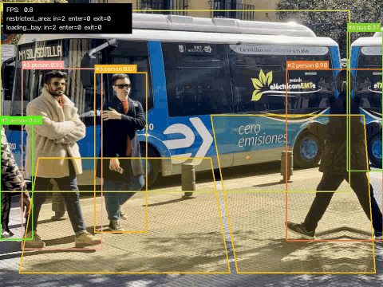
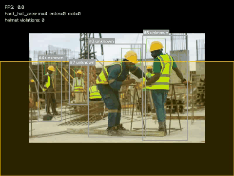
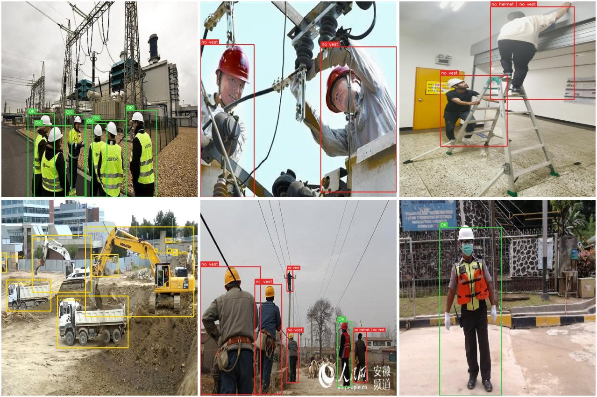
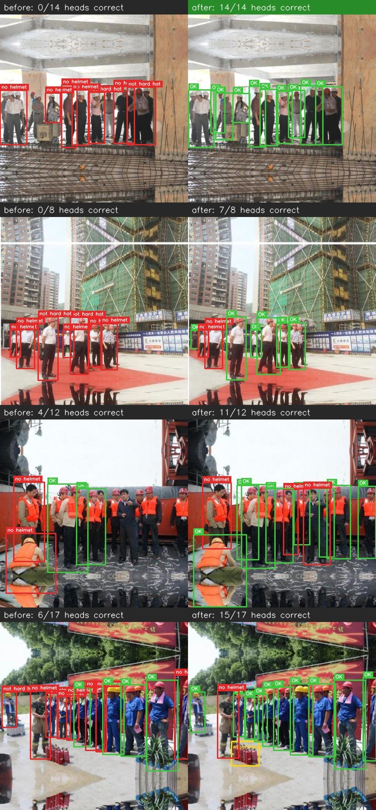
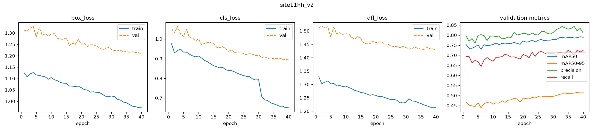
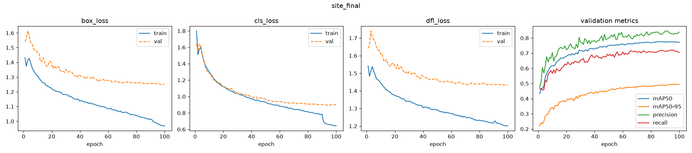
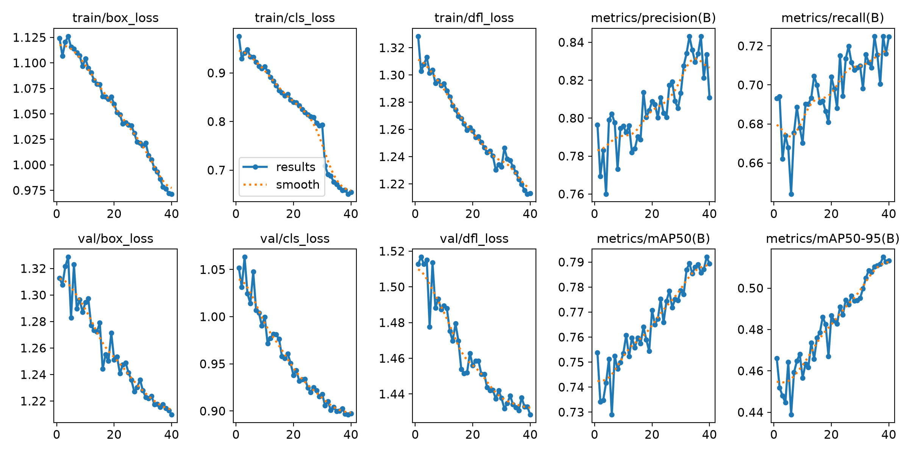
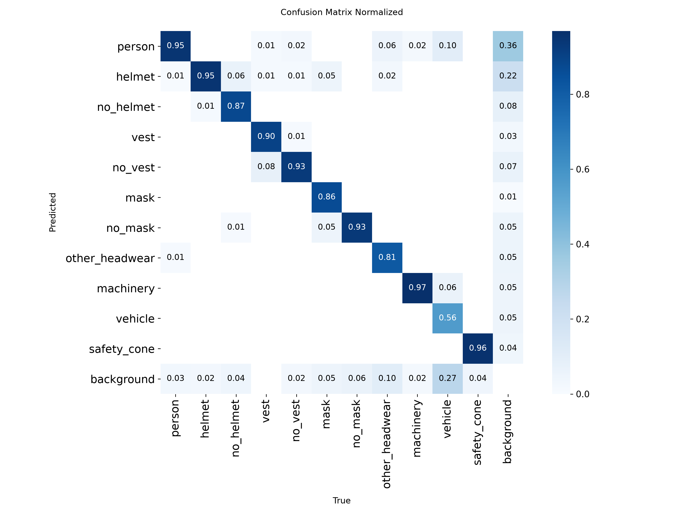
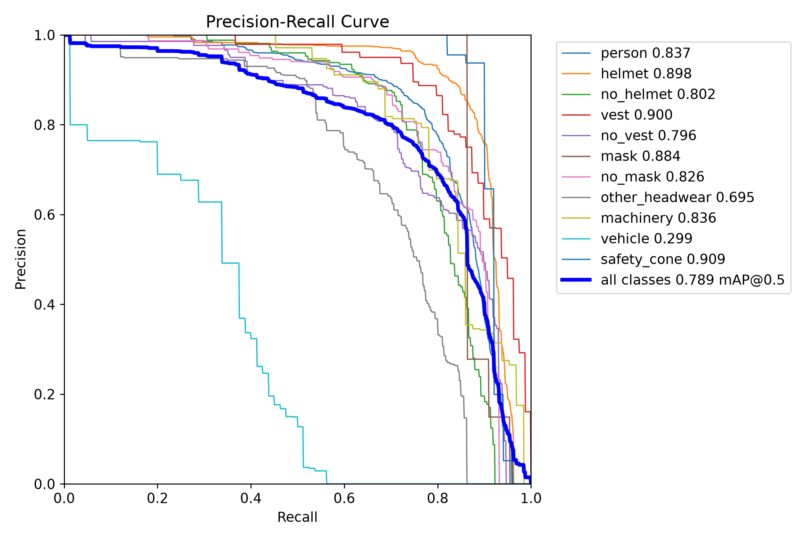
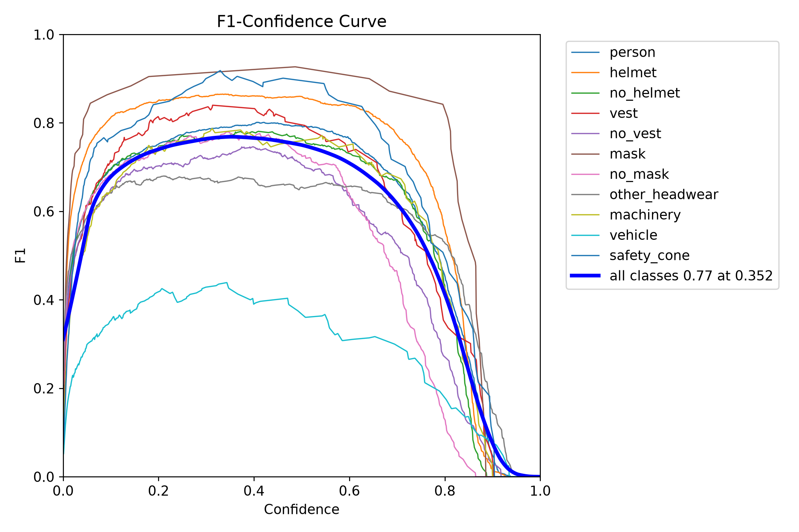

# Edge Perception Agent

**Real-time object detection, multi-object tracking and zone analytics, deployed on CPU with ONNX Runtime in Python and C++, with INT8 quantization, and an LLM + VLM agent that answers natural-language questions about the video.**



The project takes a detector from PyTorch to an edge-ready deployment and documents every step:

| Stage | What is implemented |
|---|---|
| **Perception** | YOLOv8 detection + ByteTrack multi-object tracking with persistent IDs and motion trails |
| **Scene analytics** | Polygon zones with per-class filters, occupancy, enter/exit events logged as JSON |
| **Export** | PyTorch → ONNX (static shape, opset 12) |
| **Inference from scratch** | Letterbox pre-processing, YOLOv8 output decoding and class-aware NMS written by hand, in **Python** and in **C++** (ONNX Runtime C++ API) |
| **Optimization** | Post-training static INT8 quantization (QDQ, per-channel), calibrated on deployment frames |
| **Serving** | FastAPI REST service in a slim Docker image with no PyTorch dependency |
| **Scene agent** | LLM with tool calling over the tracker's logs + a vision-language model on keyframes; runs locally with Ollama |
| **Use case: worker safety** | Fine-tuned hard-hat detector, helmet-to-worker association, temporal smoothing, zone rules, evidence crops, VLM verification of violations |
| **Quality** | Unit tests (zones, agent loop, API payloads), GitHub Actions CI, reproducible benchmark script |

---

## Results

All numbers below were measured on one machine: a workstation with an **AMD Ryzen 9 7900X** (12 cores) and an **NVIDIA RTX 4090**.

### Latency (batch 1, 640×640 input, end-to-end incl. pre/post-processing)

**CPU: AMD Ryzen 9 7900X (12 cores)**

| Backend | Mean (ms) | p95 (ms) | FPS | vs PyTorch CPU |
|---|---:|---:|---:|---:|
| PyTorch FP32 (Ultralytics) | 13.4 | 15.3 | 74.4 | 1.00× |
| ONNX Runtime FP32 (hand-written pipeline) | 31.5 | 40.4 | 31.7 | 0.43× |
| **ONNX Runtime INT8 (static PTQ)** | **19.8** | **24.5** | **50.5** | 0.68× |

Time per stage: FP32 = 5.8 ms pre-processing + 24.3 ms inference + 1.0 ms post-processing; INT8 = 4.9 + **13.6** + 0.8 ms.

**GPU: NVIDIA GeForce RTX 4090**

| Backend | Mean (ms) | p95 (ms) | FPS |
|---|---:|---:|---:|
| PyTorch FP32 (Ultralytics) | 3.6 | 4.1 | 280.9 |
| PyTorch FP16 (Ultralytics, half=True) | 3.6 | 4.0 | 279.8 |

| Model | Size |
|---|---:|
| `yolov8n.onnx` (FP32) | 12.9 MB |
| `yolov8n_int8.onnx` | 3.7 MB (**3.4× smaller**) |

**What the numbers say:**
- **INT8 halves the inference time of the ONNX model** (24.3 → 13.6 ms, 1.8×; 1.6× end to end) and makes it 3.4× smaller, with all detections kept (below).
- **On this 12-core desktop CPU, PyTorch is still faster than the ONNX pipeline**, even after quantization. ONNX's advantage here is deployability (no PyTorch, a C++ runtime, a 3.7 MB model), not raw speed on a large CPU. The real test for INT8 is a small edge CPU (ARM, Jetson), which is the next step.
- **FP16 gives nothing on the GPU** (3.6 ms in both cases). At batch 1, YOLOv8n is far too small to keep an RTX 4090 busy: the time goes into pre/post-processing and kernel launches, not into arithmetic. Half precision would only pay off with larger models or batches.

**Benchmarking lessons (two bugs in my own benchmark, found while measuring):**
1. *Unfair comparison.* Ultralytics silently runs on CUDA when a GPU is present, so the first table compared PyTorch on the RTX 4090 with ONNX on the CPU (3.0 ms vs 22.3 ms). Every row is now pinned to its device, with separate CPU and GPU sections.
2. *Interference between runtimes.* With every backend in one Python process, the ONNX Runtime CPU numbers were erratic (FP32 between 22 and 43 ms, INT8 between 16 and 40 ms) while PyTorch stayed stable at 13.4 ms: PyTorch's CPU thread pool kept competing with ONNX Runtime's. Each backend now runs in its own process.

Pre-processing was also moved from NumPy to single OpenCV calls (`copyMakeBorder`, `blobFromImage`, bit-identical output), and the benchmark reports the time spent in pre-processing, inference and post-processing for the ONNX rows. Reproduce with `python scripts/benchmark.py --runs 50`.

### Accuracy check after INT8 quantization

On the sample images, **INT8 finds 7 of 7 FP32 detections again** (same class, box IoU ≥ 0.5), with a largest confidence drop of 0.13 (full table: `results/int8_check.md`).

Reproduce with `python scripts/compare_int8.py`.

---

## Scene agent: ask questions about the video

```text
$ python -m epa.agent --run results/street -v \
    -q "How many people entered the crosswalk after 10 s, and what was the first one wearing?"
  -> count_events({"zone": "crosswalk", "event": "enter", "object_class": "person", "t_start": 10})
  -> look_at_frame({"t": 12.4, "question": "What is the person entering the crosswalk wearing?"})
```

The agent splits each question between two kinds of evidence:

| Question type | Answered by | Why |
|---|---|---|
| Counts, times, occupancy, durations, track IDs | Tools over `events.jsonl` / `tracks.jsonl` | Exact numbers from the tracker; the LLM never estimates a count |
| Appearance, actions, scene context | `look_at_frame` → vision-language model on the nearest saved keyframe | The tracker records boxes and classes, not what things look like |

**Tools:** `get_video_summary`, `count_events` (zone / event / class / time window), `zone_occupancy` (at a time, or peak and mean), `objects_at`, `track_history`, `look_at_frame`.

**Design choices**
- The LLM sees tool results, never raw logs: the context stays small even for long videos, and every number in an answer can be traced back to a tool call (`-v` prints them).
- Keyframes are saved on every zone event and every 2 s, so the VLM always has a frame close to anything that happened.
- The client speaks the OpenAI-compatible chat API, so the same code runs with a local Ollama server (default, free, offline), vLLM, LM Studio or a hosted API.
- Malformed tool arguments return an error to the model instead of crashing, and the loop stops after a fixed number of steps.

**Run it locally (free, no API key):**

```bash
# install Ollama from https://ollama.com, then:
ollama pull qwen2.5:7b        # planner with tool calling
ollama pull qwen2.5vl:3b      # vision-language model
python -m epa.agent --run results/street          # interactive mode
```

Other models: `--model`, `--vlm`, `--base-url`, or the `EPA_LLM_*` environment variables (see `src/epa/llm.py`).

---

## Use case: PPE compliance (hard hat, high-visibility vest, mask) in restricted zones

Raises an alert when a worker **without a helmet** or **without a high-visibility vest** stays inside a zone that requires it, saves a cropped image as evidence, and lets the agent verify each alert with the vision model. Each zone lists what it requires: `"requires": ["helmet"]`, `["helmet", "vest"]` or `["helmet", "vest", "mask"]` (see `configs/site_safety_zones.json`).



**How a violation is decided**

1. **Detect**: a YOLOv8n fine-tuned on three classes: `person`, `helmet`, `no_helmet`.
2. **Associate**: each `helmet` / `no_helmet` box is attached to the tracked person whose head region (top of the body box) contains it; with several workers close together, the nearest head wins and each box is used once.
3. **Smooth**: per worker, a majority vote over the last 15 frames gives `helmet`, `no_helmet` or `unknown`, so one wrong detection does not trigger anything.
4. **Rule**: `no_helmet` inside a zone configured with `"requires": ["helmet"]` for ≥ 1 s → one violation. It is re-armed only after the worker leaves the zone or puts a helmet on, so one incident gives one alert, not one per frame.
5. **Evidence**: the worker's crop is saved to `evidence/`, and the agent's `inspect_violation` tool asks the VLM for a second opinion.



*Released model on held-out construction-site images. Green `OK`: hard hat and vest worn. Red: what is missing (`no vest`, `no helmet`, `not hard hat`). Grey `?`: cannot be judged (operator in a cab, person too small or hidden). Yellow: machines and vehicles.*

**Two detector options.**

| Model | Classes | Data |
|---|---|---|
| `ppe3` / `ppe4` | person, helmet, no_helmet (+ vest) | [Construction-PPE](https://docs.ultralytics.com/datasets/detect/construction-ppe/) (Ultralytics, AGPL-3.0) |
| `site8` / `site11` | person, helmet, no_helmet, vest, no_vest, mask, no_mask, **other_headwear** (+ machinery, vehicle, safety_cone) | Construction Site Safety (Roboflow, CC BY 4.0) + headwear images from [Open Images V7](https://storage.googleapis.com/openimages/web/index.html) |

`other_headwear` exists because a hard-hat dataset only knows "hard hat" and "bare head": the headwear stress test below showed the model accepting a sun hat and a bicycle helmet as hard hats. Open Images has labelled bicycle helmets, hats, sun hats, cowboy hats, football helmets and swim caps; `scripts/prepare_site_safety.py` downloads such images with FiftyOne and labels that headwear `other_headwear` (images that also contain Open Images' generic "Helmet" class are skipped, since it mixes hard hats with other helmets). A worker in `other_headwear` is treated as having no hard hat, and the violation records `"headwear": "other_headwear"`, so the alert can say *wearing a non-work helmet / hat* instead of *no helmet*.

**Hazards around people** (`--hazards`, `src/epa/hazards.py`, model with `machinery` / `vehicle` / `safety_cone`):

- `machine_proximity`: a worker closer to a machine or vehicle than one of his own body heights, for ≥ 0.5 s. Measuring in person heights adapts the threshold to the distance from the camera. A single camera has no depth, so the gap is measured *on the ground*: the worker's feet against the machine's lower half (its footprint), not against the whole box, so a worker standing far behind a machine, who overlaps it in the image, is not "near". Operators in the cab (box inside the machine, feet above its footprint) are ignored. Machines are tracked, so each alert says whether the machine was moving (`--only-moving` restricts alerts to moving machines).
- `cone_area_entry`: cones seen in the last 3 s (cone detections flicker) define an area, their convex hull; a person (or, with `--cone-keep-out vehicle`, a vehicle) standing inside it for ≥ 0.5 s raises a violation. Cones in a line define no area.
- Limits: distances are approximate (no depth), "moving" comes from image motion (a panning camera makes everything move), and there are fewer machine / cone examples than people in the data.

**Results of the main model (`site11_960`: YOLOv8n, fine-tuned at 960 px from the 640 px model; held-out test split: 82 Construction Site Safety + 175 Open Images images)**

Detector, mAP50 per class (640 px model in brackets):

| person | helmet | no_helmet | other_headwear | vest | no_vest | mask | no_mask | machinery | vehicle | safety_cone |
|---:|---:|---:|---:|---:|---:|---:|---:|---:|---:|---:|
| 0.73 (0.74) | 0.96 (0.93) | 0.54 (0.60) | 0.74 (0.74) | 0.90 (0.86) | 0.76 (0.78) | 0.77 (0.77) | 0.85 (0.74) | 0.85 (0.83) | 0.57 (0.49) | 0.47 (0.41) |

What the system decides for each labelled worker (`scripts/eval_safety.py --split test`), 960 px vs 640 px:

| Item | Missing item caught ↑ | Missing item called "worn" ↓ | False alarms when worn ↓ | Worn item recognised ↑ |
|---|---:|---:|---:|---:|
| Hard hat (bare head) | **68 %** (62 %) | **0 %** (2 %) | **4 %** (5 %) | **83 %** (80 %) |
| Hard hat (cap, sun hat, bicycle helmet...) | 74 % (76 %) | **0 %** (0 %) | | |
| Vest | **80 %** (76 %) | 0 % (0 %) | **3 %** (5 %) | **87 %** (82 %) |
| Mask (never inferred) | **83 %** (77 %) | 0 % (0 %) | 4 % (0 %) | 73 % (77 %) |

**On construction-site images only** (the 82 Construction Site Safety test images; all hard hats, bare heads and vests of the test split are there, the Open Images part only adds non-work headwear):

| Label ↓ / decision → | helmet | no_helmet | unknown | person not detected |
|---|---:|---:|---:|---:|
| hard hat (101) | **84** | 4 | 2 | 11 |
| bare head (40) | **0** | **27** | 6 | 7 |

| Label ↓ / decision → | vest | no_vest | unknown | person not detected |
|---|---:|---:|---:|---:|
| vest (61) | **53** | 2 | 1 | 5 |

On site: 4 % false alarms on hard hats, 3 % on vests, and no bare head ever accepted as a hard hat. Of the 13 bare heads not flagged, 7 are people the detector did not find and 6 are judged `unknown` (head too small or hidden): the system abstains rather than guessing.

Two observations:
- **Nothing missing was ever accepted as worn**: not one bare head and not one of the 191 workers in non-work headwear was taken for a hard hat, and no missing vest or mask was taken for one.
- The `no_helmet` box mAP *dropped* at 960 px (0.60 → 0.54), yet more bare heads are caught per worker (62 % → 68 %): helmets are found better (0.93 → 0.96), so inferring "no helmet" from a clearly visible head without one works better. Box metrics and system decisions do not always move together, which is why both are reported.

Most remaining misses are people the detector does not find at all (crowds, small or cut-off people). Vehicles and cones stay the weakest classes (0.57 / 0.47) even at 960 px; the cone rule remembers cones for 3 s to bridge missed detections. Splits are small (e.g. 26 masks), so one error moves a percentage by several points. The 960 px model is about 2x slower than the 640 px one; both are kept (`--imgsz` picks the trade-off).

Training curves (`scripts/training_report.py --run site11_960 site11_gpu --tensorboard` writes a per-epoch table, a PNG and TensorBoard logs): the sudden drop of the training classification loss 10 epochs before the end is Ultralytics switching mosaic augmentation off (`close_mosaic`), not an anomaly.

**External test: new sites, cameras and people.** The test split above comes from the same sources as the training data. To measure generalisation, the system was run on [Hard Hat Workers](https://huggingface.co/datasets/Voxel51/hard-hat-detection) (CC0, ~5k images, mostly Chinese construction and power sites), which no model had seen (`scripts/external_test.py`). It exposed a real weakness: coloured hard hats (red, blue, purple, pink) were often judged `other_headwear` or `no_helmet`, giving 18 % false alarms. Fix (`scripts/prepare_hardhat.py`): 500 images were set aside first and never trained on; the other 4.5k were added to training, with the dataset's own helmet / head labels and the current model's confident predictions (≥ 0.5) filling the classes the dataset does not label (vests, machines, unlabelled people), so they are not learned as background. Same 500 held-out images, before / after:

| Held-out external images (1995 hard hats, 591 bare heads) | Before (`site11_960`) | v1 (`site11hh`) | **v2 (`site11hh_v2`)** |
|---|---:|---:|---:|
| Bare heads caught ↑ | 61 % | 67 % | **70 %** |
| Bare heads called "helmet" ↓ | 4 % | 4 % | **3 %** |
| **False alarms on hard hats** ↓ | 18 % | 1 % | **1 %** |
| Hard hats recognised ↑ | 51 % | 66 % | **70 %** |
| Hard hats on people not detected ↓ | 578 | 659 | **560** |
| Heads fixed / broken vs before (`scripts/compare_models.py`) | | 458 / 126 | **518 / 69** |
| Images better / worse / unchanged | | 189 / 45 / 266 | **214 / 25 / 261** |

**v1 fixed the hard hats but lost people.** Reviewing `results/compare/worse/` (the most degraded images, saved automatically so the review is not cherry-picked) showed one main cause: more workers were not detected at all (578 → 659), in crowds, close-ups, top-down and night views. The external dataset rarely labels people, and v1 only added the previous model's predictions at confidence ≥ 0.5 as pseudo-labels, so many real people stayed unlabelled and were learned as background (a false `machinery` box over a whole electrical cabinet came from the same source). **v2 lowers the person pseudo-label threshold to 0.3** (`--person-conf 0.3`), everything else unchanged: missed people drop below the original model (560), and the regressions fall from 126 to 69 heads. The remaining v2 regressions (`results/compare_v2/worse/`) are all **missed people, not wrong decisions**: in the reviewed worst cases no worker with a hard hat was flagged and no bare head was accepted; workers in a tight group, seen from above or partly hidden were simply not detected. Part of them are also an artefact of the dataset, whose 416 px images were padded with mirrored copies: heads in the mirrored borders count as ground truth.



*Held-out external images, before (left) and after (right) adding the external data. Coloured hard hats that were called "no helmet" or "not hard hat" are recognised.*

On the original test split v2 keeps its behaviour: bare heads called "helmet" 0 %, false alarms on hard hats 2 % (4 % before), hard hats recognised 87 % (83 %), bare heads caught 65 % (68 %; 40 heads, so one head is 2.5 points). The one cost: 2 % of the 191 workers in non-work headwear (4 people) are now accepted as wearing a hard hat (0 before) and 71 % are caught (74 %): with 16k extra hard hats in training, the helmet class became more permissive. **`site11hh_v2` is the released model.**

**Control experiment: one clean training run.** `site11hh_v2` is the end of a chain of fine-tunings (640 px → 960 px → + external data). To check that the chain does not hide anything, the same final dataset was trained once from the COCO weights for 100 epochs with no early stopping (`site_final`: `--weights yolov8n.pt --epochs 100 --patience 0`):

| | `site11hh_v2` (released) | `site_final` (single run) |
|---|---:|---:|
| External: bare heads caught ↑ | 70 % | **72 %** |
| External: bare heads called "helmet" ↓ | **3 %** | 4 % |
| External: false alarms on hard hats ↓ | 1 % | 1 % |
| External: hard hats recognised ↑ | 70 % | **72 %** |
| External: hard hats on people not detected ↓ | 560 | **538** |
| Test: bare heads called "helmet" ↓ | **0 %** | 2 % (1 of 40) |
| Test: hard hats recognised ↑ | **87 %** | 82 % |
| Test: non-work headwear called "helmet" ↓ | 2 % | **1 %** |
| Test: `helmet` box mAP50 | **0.93** | 0.78 |
| Best validation mAP50 | **0.787** (epoch 38/40) | 0.774 (epoch 97/100) |

The two are close; the single run is slightly better on the external sites and worse on the original data, mostly on the `helmet` box. A likely cause is **box style**: Hard Hat Workers draws helmet boxes differently from Construction Site Safety, and with 16k external helmet boxes in the training data the single run learned the external style, while `site11hh_v2`, fine-tuned from a model that had already learned the original style, kept it. The released model stays `site11hh_v2`, which is better on the error that matters most (a bare head accepted as a hard hat: 0 % on the original test split). The single run's curves are a clean reference: train and validation losses fall together for 100 epochs, validation box loss is flat from epoch ~85 (the model has converged), and train cls loss drops at epoch 91 when mosaic augmentation is switched off.

**Training diagnostics** (images in `assets/training/`). Released model `site11hh_v2`: 40 epochs at 960 px from `site11_960`, best epoch 38 (validation mAP50 0.787, mAP50-95 0.515; its validation split includes 200 Hard Hat Workers images, so these numbers are not comparable to `site11_960`'s). Train and validation losses keep falling together to the end (val box 1.51 → 1.43, val cls 1.05 → 0.90): no overfitting. The step in train cls loss at epoch 31 is mosaic augmentation switched off for the last 10 epochs. The notes below refer to `site11_960`, the base model:

Per-epoch losses (box, cls, dfl; train and validation) and validation metrics of the released model, and of the single 100-epoch control run:




| Ultralytics plots (released model) | |
|---|---|
|  |  |
|  |  |

Full per-epoch tables: [`docs/training/site11hh_v2_epochs.md`](docs/training/site11hh_v2_epochs.md), [`docs/training/site_final_epochs.md`](docs/training/site_final_epochs.md). The same numbers can be browsed interactively: `python scripts/training_report.py --run site11hh_v2 site_final --tensorboard && tensorboard --logdir runs/tensorboard`.

- *Curves*: train and validation losses fall together and validation mAP is still rising at the last epoch, so there is no overfitting and a longer run could add a little more. The step in `train/cls_loss` at epoch 50 is mosaic augmentation being switched off for the last 10 epochs.
- *Confusion matrix*: the PPE classes barely mix with each other. A real hard hat is predicted as `other_headwear` in 3 % of cases, and non-work headwear as a hard hat in < 1 % (1 box out of 306), which is the error that matters most. The largest error is not confusion but **missed objects** (bottom row): 29 % of vehicles and 15 % of bare faces (`no_mask`) are not detected at all, and many background regions are predicted as `person` (crowds, posters, partly visible people).
- *F1-confidence curve*: F1 over all classes peaks at a confidence of **0.42**; the pipeline default (0.3) favours recall, which suits a safety system where the decision rules and temporal smoothing filter the extra detections.
- *Validation vs test*: per-class numbers differ a lot between the two small splits (cones 0.90 mAP50 on val, 0.47 on test; vehicles 0.33 vs 0.57), another sign that a few dozen examples per class are not enough for stable per-class figures.

**Vests** follow the same five steps with a **torso** region (15–65 % of the body height) instead of the head, and their own rule `vest_required`. Construction-PPE has a `vest` class but no "no vest" class, so there a missing vest is always inferred from absence (with `site8`, detected `no_vest` boxes are used as direct evidence too): a torso that is clearly visible (person tall enough at the detector's resolution, not hidden behind someone nearer the camera) with no vest box on it. A vest box must also be at least 30 % as wide as the person, so the vest of a worker standing behind is not given to the one in front (the same depth check as `--min-ppe-width` for helmets, see the stress tests below). The helmet logic is unchanged when vests are checked.

`unknown` (head occluded, too small, turned away) never raises an alert: in a safety system, false alarms make people ignore the alerts. Unknowns are still logged for review.

```bash
# dataset (AGPL-3.0): unzip into datasets/construction-ppe/
#   https://github.com/ultralytics/assets/releases/download/v0.0.0/construction-ppe.zip
python scripts/prepare_ppe_dataset.py --src datasets/construction-ppe --dst datasets/ppe3
python scripts/train_ppe.py --data datasets/ppe3/data.yaml --epochs 100   # GPU if available, else CPU
PYTHONPATH=src python -m epa.pipeline --source site.mp4 --model models/ppe_yolov8n.onnx \
    --zones configs/safety_zones.json --safety --out results/site
python -m epa.agent --run results/site -q "List the helmet violations and verify each one."

# site11: hard hat vs other headwear, vest, mask, machines, vehicles, cones
pip install fiftyone                     # Open Images download
python scripts/prepare_site_safety.py --css datasets/css --dst datasets/site11
python scripts/train_ppe.py --data datasets/site11/data.yaml --epochs 100 --name site11_yolov8n
PYTHONPATH=src python -m epa.pipeline --source site.mp4 --model models/site11_yolov8n.pt --imgsz 1280 \
    --zones configs/site_safety_zones.json --safety --hazards --out results/site11

# helmet + vest: 4-class model (person, helmet, no_helmet, vest)
python scripts/prepare_ppe_dataset.py --src datasets/construction-ppe --dst datasets/ppe4 --with-vest
python scripts/train_ppe.py --data datasets/ppe4/data.yaml --epochs 100 --name ppe4_yolov8n
python scripts/eval_safety.py --data datasets/ppe4 --model models/ppe4_yolov8n.onnx --split val --sweep
PYTHONPATH=src python -m epa.pipeline --source site.mp4 --model models/ppe4_yolov8n.pt --imgsz 1280 \
    --zones configs/ppe_zones.json --safety --out results/site_ppe
```

**Detector results** (held-out test split, 141 images)

| Class | Precision | Recall | mAP50 | mAP50-95 |
|---|---:|---:|---:|---:|
| person | 0.81 | 0.80 | 0.84 | 0.49 |
| helmet | 0.89 | 0.91 | **0.94** | 0.51 |
| no_helmet | 0.45 | 0.15 | **0.14** | 0.04 |
| **all** | | | **0.64** | **0.35** |

YOLOv8n fine-tuned for 100 epochs at 640×640 on an RTX 4090 (~2 s per epoch).

**More training did not fix the weak class.** A short run (20 epochs, 416×416) gave `no_helmet` mAP50 = 0.16; five times more epochs at a higher resolution gave 0.14, while `helmet` went from 0.92 to 0.94. The bottleneck is the data (about 400 `no_helmet` examples, mostly outside construction sites, see below), not the training budget, so the fix had to come from the decision logic instead.

**System-level evaluation (per worker).** mAP scores boxes; what matters for safety is the decision taken for each worker. `scripts/eval_safety.py` matches the system's people to the labelled ones (IoU ≥ 0.5) and compares its decision with the label. Rule variants were compared on the **validation** split, and the chosen rules were then measured once on the **test** split.

**Rule variants, validation split** (143 images: 167 labelled workers with a helmet, 45 labelled bare heads):

| Rules | Bare heads caught ↑ | Bare heads called "helmet" ↓ | False alarms on helmets ↓ | Helmets recognised ↑ |
|---|---:|---:|---:|---:|
| **Current rules** | **89%** | **4%** | **4%** | **82%** |
| No inference from absence | 36% | 4% | 0% | 82% |
| Helmet centred above person (dx ≤ 0.35 w) | 89% | 4% | 4% | 79% |
| Helmet centred above person (dx ≤ 0.25 w) | 89% | 4% | 4% | 78% |
| No side margin on the head region | 89% | 4% | 4% | 82% |
| Shorter head region (25 % of height) | 89% | 4% | 5% | 81% |
| Centred 0.35 + shorter 25 % | 89% | 4% | 5% | 78% |

**Final result, test split** (141 images: 154 labelled workers with a helmet, 40 labelled bare heads), current rules:

| Bare heads caught | Bare heads called "helmet" | False alarms on helmets | Helmets recognised |
|---:|---:|---:|---:|
| **80%** | **0%** | **3%** | **85%** |

| Label ↓ / decision → | helmet | no_helmet | unknown | person not detected |
|---|---:|---:|---:|---:|
| helmet | 131 | 4 | 0 | 19 |
| no_helmet | 0 | 32 | 1 | 7 |
| unlabelled (no head label) | 7 | 12 | 1 | 22 |

*Limit of this evaluation:* the dataset labels people and helmets separately, without saying which helmet belongs to whom, so the ground-truth status is also derived by geometry (a labelled head box inside the upper 40 % of the person box). In occlusion cases like the one below, the ground truth makes the same mistake as the system, so this kind of error is not counted.

Three conclusions: the *infer-from-absence* rule (below) is what makes the system work (89 % of bare heads caught instead of 36 %); none of the tighter association rules I tried improved the system overall, so they were not adopted; and the largest remaining loss is workers the detector does not find at all, not the rules.

**Known limitation: helmet of a hidden worker.** Found while reviewing the annotated test images (`scripts/detect_images.py`): in `image796.jpg` a bald man is labelled "helmet": a worker standing behind him is hidden except for his red helmet, which appears right above the bald head in the 2D image, and the only body it can be matched to is the bald man's. A single image does not tell who stands in front of whom. Tighter matching rules (helmet centred above the person, shorter head region) did not fix this without hurting other cases (see table), so the case is handled by the VLM check of each violation instead: the vision model looks at the head itself. Better fixes would be a head or pose detector, or depth.

**Weak `no_helmet` class → infer from absence.** Helmets are detected well (recall 0.91), bare heads poorly (recall 0.15). Relying on `no_helmet` detections alone, the system catches only **36 %** of labelled bare heads (validation split): most bare-headed people stay `unknown`. Since the helmet class is reliable, a **missing** helmet on a **clearly visible** head is used as evidence too. "Clearly visible" means the person is at least 100 px tall *at the detector's input resolution*, not cut by the top of the image, not hidden behind someone nearer the camera, and no PPE box of any kind sits on the head. Each violation records `evidence_type` (`detected` or `inferred_from_absence`), and the agent is told to verify inferred ones with the VLM first.

**False alarm from duplicate boxes.** The first version of that rule flagged a worker who *was* wearing a helmet. The detector had produced two overlapping boxes for the same person; the single helmet was matched to one of them, and the other "had no helmet". Fix: absence is only inferred when the head region contains no PPE box at all, including one already matched to another person. A unit test reproduces the case.

**One worker, two alerts (nested duplicate box).** With the GPU-trained model, one bare-headed man in the last test segment produced two violations. My first guess was a tracker ID switch, and the fix I wrote for that did nothing. Printing the per-frame tracks showed the real cause: track #25 covered his whole body `[30, 84, 703, 524]` while a second track #30 `[0, 75, 385, 520]` sat on his left half *at the same time*, with the same bottom edge. Fix: a box that lies ≥ 70 % inside another one **and touches the ground at the same height** is the same worker, so its alert is logged as a duplicate (`same_footprint`). A different person standing behind him also overlaps, but has his feet higher in the image, so he is not merged. The guard against real ID switches is kept too: a violating worker who vanished less than 3 s earlier at the same place (`id_switch`). Both cases are unit-tested with the coordinates from this run.

On the test video (held-out test images: workers with hard hats, then bare-headed people) the final rules give **0 violations in the helmet segment** (no false alarm on any worker wearing a hard hat), flag the bare-headed people in the restricted zone, and suppress the duplicate alert.

**Two more bugs found on a 1080p video** (an AI-generated demo clip, see below):
1. *Resolution.* At a 416 px input, the helmets of workers standing ~15 m away shrink to about 5 px and are not detected, while the workers themselves look large in the 1920 px frame, so absence-inference flagged helmeted workers. The "clearly visible head" test now measures the person at the detector's resolution: at low resolution the system abstains (`unknown`) instead of raising false alarms, and at `--imgsz 1280` it sees the helmets.
2. *Occlusion re-arming an alert.* When the bare-headed worker walked in front of helmeted colleagues, their helmets were briefly matched to him, which reset his alert and produced a second one. A helmet must now be seen for 2 s before an alert re-arms, and status smoothing uses a fixed 1.5 s window (it was 15 frames: 1.5 s at 10 fps but only 0.5 s at 30 fps).

**Dataset limitation found during evaluation.** In the [Construction-PPE dataset](https://docs.ultralytics.com/datasets/detect/construction-ppe/), most `no_helmet` examples are people in everyday scenes (offices, sports, events), while most `helmet` examples are on construction sites. A model can partly learn *"construction background → helmet"* instead of looking at the head, and then miss bare-headed workers on a real site. Next step: add on-site images of workers without hard hats and evaluate separately on that subset. This is also why the agent's VLM verification is useful: it checks the head itself, not the scene.

### Stress tests on harder videos

Two AI-generated clips were used to look for failure modes the dataset does not show (results are qualitative: there is no ground truth for these videos).

- **Crowd (~15 workers crossing each other).** A bare-headed man walking close to the camera was called "helmet": his body box is large, so his head region also covered the helmets of the workers *behind* him. A helmet that belongs to a person must be roughly as wide as that person's head, while those background helmets were only 0.11–0.26 of his body width (correctly matched helmets: ≥ 0.29). The option `--min-ppe-width 0.25` ignores PPE boxes that are too small for the person and fixes this case. Remaining issue: many tracker ID switches in a dense crowd (48 track IDs for about 15 people). The duplicate-alert guard keeps this from producing repeated alerts, but people counts are inflated.
- **Non-work headwear.** Knitted beanie, hijab without a hard hat and a motorcycle helmet were flagged as violations; **a straw sun hat and a bicycle helmet were accepted as hard hats.** The model only knows two head classes (hard hat / bare head), so anything rigid on a head looks like a helmet. Fix: the `site8` model adds an `other_headwear` class trained on Open Images headwear (see above); the VLM check alone cannot catch a helmet that was accepted, since only alerts are sent to it.
- **Vests.** On the first run every worker wore a vest, yet some got vest alerts: the detector found the vest in only 40–70 % of the frames, and since "no vest" is always inferred, a run of misses was enough. A vest does not come off in 1.5 s, so "no vest" now needs ≥ 90 % of the smoothing window without one, and any vest seen means "vest" (false vest alerts 6 → 2 on the crowd clip). On still images, half of the false vest alarms came from upper-body boxes (close-ups) where the vest sits low in the box: the torso band now reaches the bottom of the box when the box is less than twice as tall as it is wide (false alarms on vest wearers 21 % → 12 %, validation split, 5-epoch CPU model).

---

## Engineering notes

**1. INT8 quantization gave zero detections at first.** YOLOv8's output tensor concatenates box coordinates (range 0–640) with class probabilities (range 0–1). A single INT8 scale for that tensor rounds every class score to zero. The fix (`scripts/quantize_int8.py`) excludes the final 1×1 prediction convolutions and the DFL / box-decoding ops from quantization, while the backbone, neck and head trunk stay INT8. That keeps almost all of the speed-up and restores accuracy.

**2. Per-channel quantization requires opset ≥ 13.** The script upgrades the graph automatically with `onnx.version_converter` before quantizing.

**3. OpenCV DNN (4.6) could not import the YOLOv8 head,** so the C++ engine uses the ONNX Runtime C++ API, the same runtime as the Python side, which also guarantees identical numerical results (verified box-for-box).

**4. Zone events use the box's bottom-centre**, not its centre, as the object's position: it approximates where the object touches the ground, which avoids false entries when a tall object's upper body overlaps a floor zone.

---

## Quick start

```bash
git clone https://github.com/MerouaBelhi/edge-perception-agent.git
cd edge-perception-agent
pip install -r requirements.txt

# 1. Export the model to ONNX, then quantize to INT8
python scripts/export_onnx.py --weights yolov8n.pt
python scripts/quantize_int8.py --model models/yolov8n.onnx --calib path/to/video.mp4

# 2. Run detection + tracking + zones on a video
PYTHONPATH=src python -m epa.pipeline --source path/to/video.mp4 \
    --model models/yolov8n_int8.onnx --zones configs/zones.json --out results/run1
#   -> results/run1/annotated.mp4, events.jsonl, summary.json

# 3. Benchmark the backends
python scripts/benchmark.py --images assets --runs 50
```

### C++ inference engine

```bash
# Download an ONNX Runtime release: https://github.com/microsoft/onnxruntime/releases
export ONNXRUNTIME_DIR=/path/to/onnxruntime-linux-x64-<version>
cmake -S cpp -B cpp/build && cmake --build cpp/build -j
./cpp/build/epa_infer models/yolov8n_int8.onnx assets/bus.jpg results/cpp_bus.jpg
./cpp/build/epa_infer models/yolov8n_int8.onnx path/to/video.mp4 results/cpp_video.mp4
```

The engine reads the input size and class names from the ONNX file, so the same binary runs the COCO model and the helmet model.

**Windows (Visual Studio 2022)**

1. Install Visual Studio 2022 (Community or Build Tools) with the **Desktop development with C++** workload; it includes CMake.
2. OpenCV: run `opencv-4.x-windows.exe` from [opencv.org/releases](https://opencv.org/releases/) and extract to `C:\opencv`.
3. ONNX Runtime: unzip `onnxruntime-win-x64-<version>.zip` from the [releases page](https://github.com/microsoft/onnxruntime/releases) to `C:\onnxruntime`.
4. In **Developer PowerShell for VS 2022**, from the project folder (use a path without non-ASCII characters):

```powershell
cmake -S cpp -B cpp/build -DOpenCV_DIR=C:/opencv/build `
      -DONNXRUNTIME_DIR=C:/onnxruntime/onnxruntime-win-x64-<version>
cmake --build cpp/build --config Release
.\cpp\build\Release\epa_infer.exe models\ppe_yolov8n.onnx assets\ppe_test.mp4 results\cpp_ppe.mp4
```

The build copies `onnxruntime.dll` and the OpenCV DLLs next to the `.exe`. This matters: Windows ships an older `onnxruntime.dll` in System32 that would otherwise be loaded and fail.

### REST API (Docker)

```bash
docker build -t edge-perception-agent .
docker run -p 8000:8000 edge-perception-agent

curl -F file=@assets/bus.jpg "localhost:8000/detect?conf=0.4"
curl -F file=@assets/bus.jpg localhost:8000/detect/annotated -o out.jpg
```

Interactive docs at `http://localhost:8000/docs`.

---

## Outputs

`events.jsonl`: one line per zone event:
```json
{"frame": 47, "t": 3.133, "zone": "restricted_area", "event": "enter", "track_id": 1, "class": "person"}
```

`tracks.jsonl`: one line per frame with every track (ID, class, box) and the occupancy of each zone.

`keyframes/`: frames saved on events and periodically, with `index.json`; used by the scene agent.

`summary.json`: totals per zone, unique tracks per class, latency mean/p50/p95.

Zones are defined in `configs/zones.json` with normalized coordinates, so the same configuration works at any resolution.

---

## Project structure

```
src/epa/
  detector_onnx.py   hand-written ONNX Runtime inference (pre/post-processing, NMS)
  pipeline.py        video pipeline: detection -> ByteTrack -> zones -> outputs
  zones.py           polygon zones, enter/exit events
  safety.py          helmet / vest / mask association, temporal smoothing, zone rules, evidence
  hazards.py         worker-machine proximity, machine motion, coned-off areas
  api.py             FastAPI service
  agent.py           scene agent: tool schemas + LLM tool-calling loop
  scene_store.py     query layer over a run (the agent's tools)
  llm.py             OpenAI-compatible client (chat with tools, vision)
cpp/
  main.cpp           C++ inference engine (ONNX Runtime C++ API + OpenCV)
scripts/
  export_onnx.py     PyTorch -> ONNX
  prepare_ppe_dataset.py  Construction-PPE (11 classes) -> person / helmet / no_helmet (/ vest)
  prepare_site_safety.py  Construction Site Safety + Open Images headwear -> 8 classes
  eval_safety.py     person-level evaluation of the helmet / vest / mask decisions
  training_report.py per-epoch table, loss curves, TensorBoard logs
  collect_assets.py  copy README figures / tables out of runs/ (git-ignored)
  external_test.py   evaluation on Hard Hat Workers (never trained on)
  prepare_hardhat.py add Hard Hat Workers to training, with a held-out part
  compare_models.py  before / after per image, most improved and most degraded
  concat_videos.py   join clips into one test video
  detect_images.py   rules on still images, per-folder summary
  train_ppe.py       fine-tune, test-split metrics, ONNX export
  quantize_int8.py   static INT8 post-training quantization
  benchmark.py       latency comparison across backends
  make_gif.py        README demo GIF
tests/               unit tests (pytest)
```

---

## Roadmap

- [x] Scene agent: natural-language questions over the tracker logs + a VLM on keyframes
- [ ] Agent endpoint in the REST API and answers grounded with a cropped image of the object
- [x] Worker safety: hard-hat compliance in restricted zones with VLM verification
- [x] High-visibility vest rule
- [x] Hard hat vs other headwear (`other_headwear` class), explicit `no_vest`, mask rule
- [x] Worker-machine proximity and coned-off areas
- [ ] Motorcycle helmets (no clean public labels) and on-site bare-head data
- [ ] Ground-plane calibration (homography) for distances in metres
- [ ] Pose estimation (YOLOv8-pose) for fall / unsafe-posture alerts
- [ ] Zone logic and tracking in the C++ engine
- [ ] Benchmarks on ARM (Raspberry Pi / Jetson) and with TensorRT

## License

MIT
